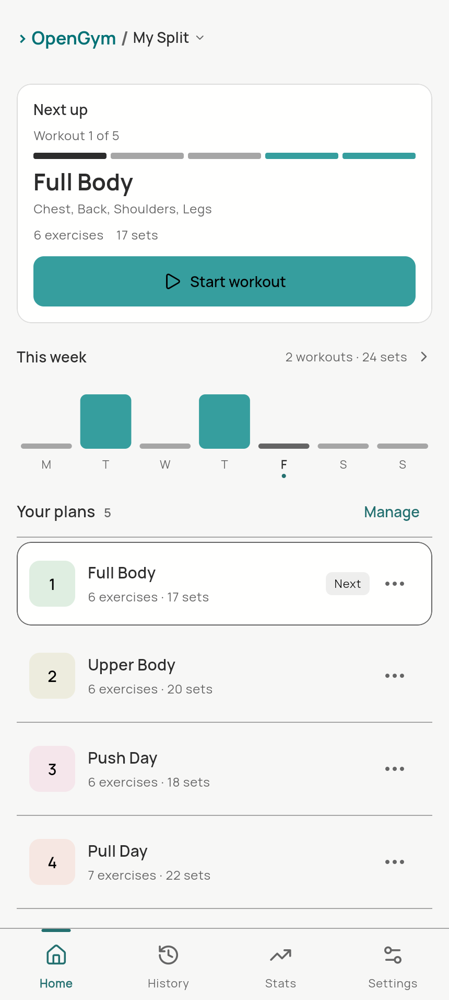
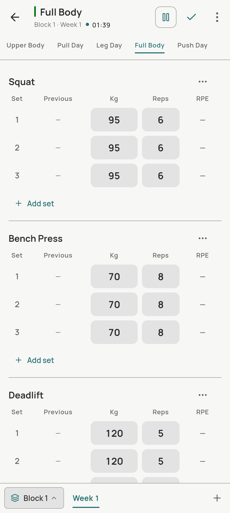
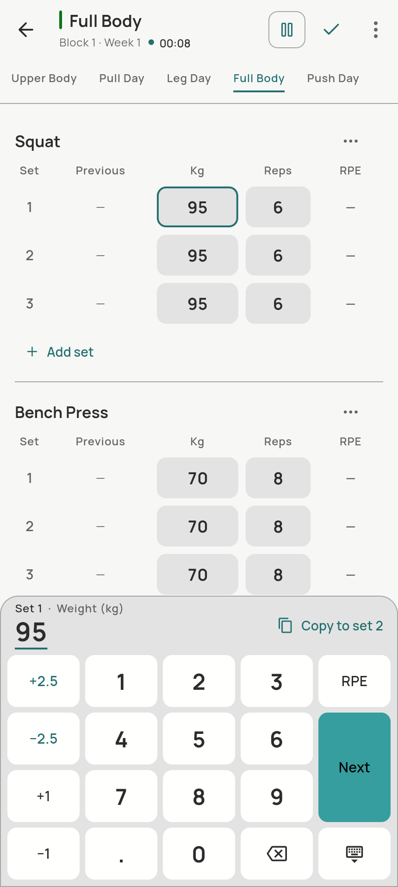
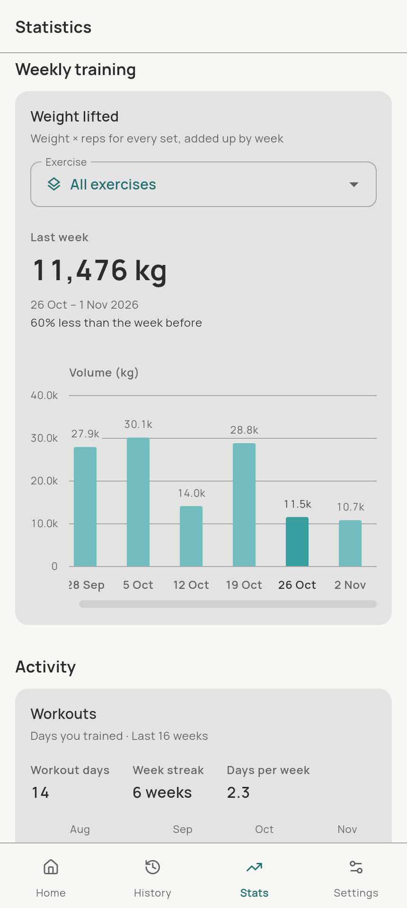
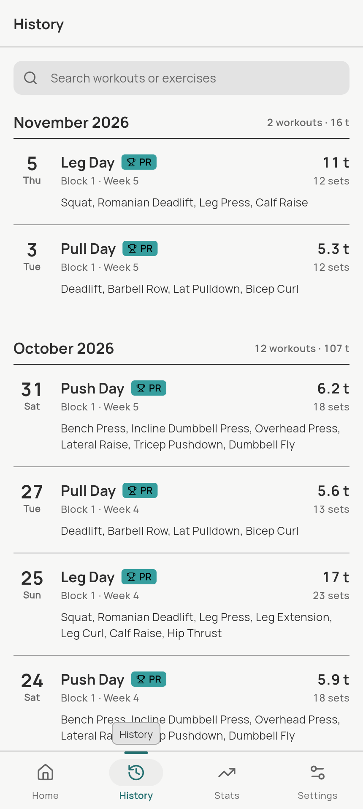
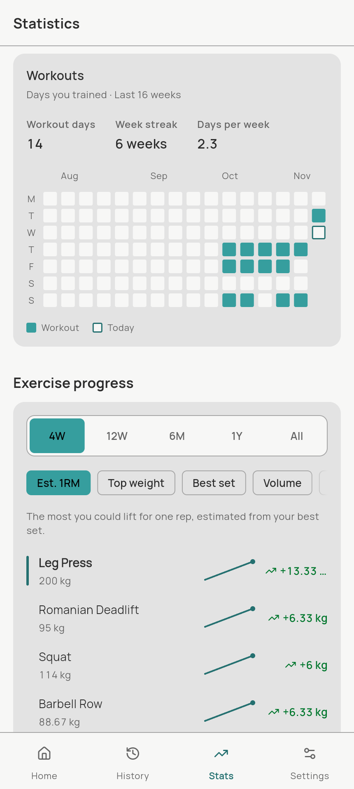
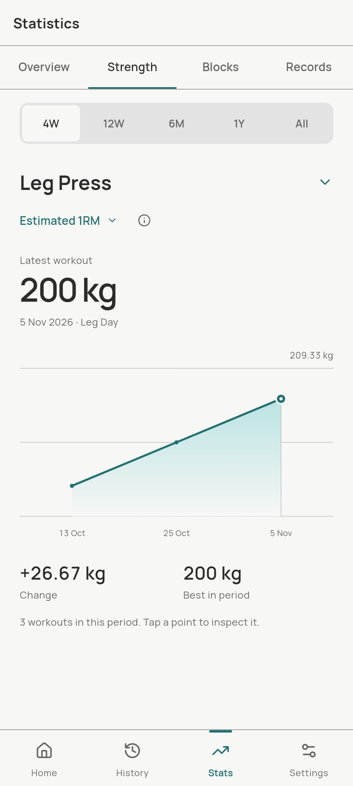
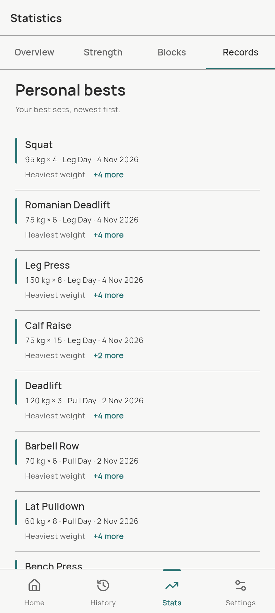

# OpenGym Product Page

The landing page and product showcase for [OpenGym](https://github.com/AalishMS/OpenGym), an offline-first workout tracking application for Android.

Built with React 19, TypeScript, and Vite.

## Screenshots

| Routine & Plans | Active Workout | Custom Keypad | Analytics |
| :---: | :---: | :---: | :---: |
|  |  |  |  |

| Workout journal | Training blocks | Strength | Records |
| :---: | :---: | :---: | :---: |
|  |  |  |  |

The current gallery and app previews reflect **v1.0.19+20**, checked against
OpenGym commit `ca88ab9` on November 6, 2026. The previews use sample data and show
the labeled Finish action, populated previous sets, the seven-day workload strip,
and focused Statistics views. Release highlights also cover live records and
shareable workout summaries.

The History timeline uses two captures of the UI changed at each milestone,
with individual captions and alt text configured in `src/history.ts`. Historical
images come from the milestone's app commit unless `captureCommit` records a
later capture of that UI. They are fitted to a 540 × 1200 phone viewport without
stretching; long web captures trim empty space below the journal.

## Features

- **Interactive 3D Phone Mockup:** Responsive phone mockup with pointer tilt effect on desktop and reduced-motion fallback.
- **Walkthrough Story:** Step-by-step presentation of core app flows (planning, logging, tracking progress) synced to scroll position.
- **Set Logging Demo:** Live interactive component demonstrating the in-app set logging interface (weight, reps, RPE).
- **Theme Switcher:** Live preview showing the 8 accent color themes available in OpenGym. Picking an accent re-themes the whole page, using the same tone solver as the app.
- **Offline Architecture:** Explains local Hive storage and optional cloud sync.
- **FAQ Section:** Answers common questions about data export, APK installation, and sync.

## Tech Stack

- **Framework:** React 19
- **Language:** TypeScript
- **Build Tool:** Vite 8
- **Animation:** Framer Motion
- **Linter:** Oxlint
- **Styles:** Plain CSS with CSS custom properties
- **Fonts:** Manrope (the app's typeface, for display and body), JetBrains Mono for data

## Project Structure

```
OpenGym_Product_Page/
├── public/
│   ├── applogo.png
│   ├── icons.svg
│   ├── og-image.png
│   └── screenshots/
│       ├── home.png
│       ├── home_dark.png
│       ├── statistics.png
│       ├── workout.png
│       └── workout_keypad.png
├── src/
│   ├── components/
│   │   ├── FAQ.tsx
│   │   ├── Footer.tsx
│   │   ├── Header.tsx
│   │   ├── Hero.tsx
│   │   ├── LoggingDemo.tsx
│   │   ├── OfflineSection.tsx
│   │   ├── Personalization.tsx
│   │   ├── PhoneFrame.tsx
│   │   └── ProductStory.tsx
│   ├── App.tsx
│   ├── config.ts
│   ├── index.css
│   └── main.tsx
├── index.html
├── package.json
├── tsconfig.json
└── vite.config.ts
```

## Getting Started

### Prerequisites

- Node.js 22.12+ (recommended) or 20.19+
- npm, pnpm, or yarn

### Installation

```bash
git clone https://github.com/AalishMS/OpenGym-Product-Page.git
cd OpenGym-Product-Page
npm install
```

### Development

```bash
npm run dev
```

Starts the local development server at `http://localhost:5173`.

### Production Build

```bash
npm run build
```

Compiles TypeScript, bundles production assets, and pre-renders the homepage and release history into `dist/`. Both pages deliver their content before JavaScript runs; React hydrates the static HTML to enable interactive previews.

To test the production build locally:

```bash
npm run preview
```

### Linting

```bash
npm run lint
```

Runs Oxlint across the project.

## Configuration

Site copy, download links, sample workouts, FAQ items, and theme palettes are defined in [`src/config.ts`](./src/config.ts). Update this file to modify content without changing component code.

## Related Links

- [OpenGym Mobile App](https://github.com/AalishMS/OpenGym) — Flutter mobile application repository
- [OpenGym Releases](https://github.com/AalishMS/OpenGym/releases/latest) — Latest Android APK downloads
- [OpenGym JSON Editor](https://github.com/AalishMS/OpenGym-JSON-Editor-) — Web tool for editing workout JSON files

## License

This project is open-source under the MIT License.

## Search and AI search

SEO copy, the canonical origin (`meta.siteUrl`), social image, and product facts
are configured in `src/config.ts`. `src/seo.ts` builds per-page titles,
descriptions, canonical URLs, social previews, and JSON-LD from that source.
The FAQ schema uses the same questions and answers as the visible FAQ. The
schema describes the free Android app without invented ratings or reviews.
FAQ markup helps describe the content; it does not promise Google FAQ rich results.

`npm run build` generates:

- `dist/index.html`: the complete product page, including installation and FAQ.
- `dist/releases/index.html`: a separate, indexable release history.
- `dist/robots.txt`: permits search crawling, including OpenAI and Claude search/retrieval agents. The existing general allow policy is preserved.
- `dist/sitemap.xml`: lists the two canonical pages. It omits `lastmod` rather than presenting an app release date as the date a page changed.
- `dist/llms.txt`: an optional plain-text product and source guide. It is not a ranking directive or a requirement for Google, ChatGPT, or Claude.

The build uses the checked-in release snapshot with no external network calls.
Visitors can still receive newer release data from GitHub after hydration.
Update `src/releases.ts` and rebuild when publishing updated release content
for crawlers. Old `#/releases` bookmarks redirect to `/releases/` in the browser.
Serve the entire `dist/` directory so `/releases/` resolves to its generated
`index.html`; do not rewrite that route to the homepage.

Run `npm run check:seo` after a production build to check pre-rendered content,
FAQ/schema consistency, canonical URLs, sitemap entries, crawler directives,
and local links and assets.

After deployment:

1. Confirm `meta.siteUrl` matches the production domain before building. Update it when moving to a custom domain.
2. Verify the property in Google Search Console and Bing Webmaster Tools, submit `/sitemap.xml`, and inspect both public URLs. Check the available Google generative AI visibility controls/reports in Search Console.
3. Use Google's Rich Results Test and Schema.org Validator to inspect the deployed structured data. No ratings are fabricated to satisfy software-app rich-result eligibility.
4. Ensure hosting/CDN rules permit public pages and assets for Googlebot, Bingbot, OAI-SearchBot, Claude-SearchBot, and Claude-User. A robots allow rule does not bypass a firewall or authentication.

These changes improve accessibility to crawlers and help describe the product;
indexing, rankings, and inclusion in AI-generated answers remain up to each service.

Official guidance:
[Google AI search optimization](https://developers.google.com/search/docs/fundamentals/ai-optimization-guide),
[OpenAI crawlers](https://developers.openai.com/api/docs/bots), and
[Anthropic crawlers](https://privacy.claude.com/en/articles/8896518-does-anthropic-crawl-data-from-the-web-and-how-can-site-owners-block-the-crawler).
